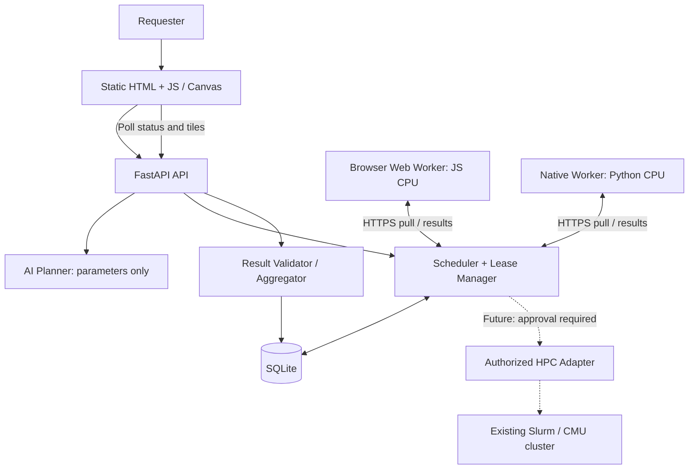

# TartanGrid · NOVA

TartanGrid 的目标是把贡献者主动授权的浏览器和个人电脑连接起来，共同完成可拆分的 Mandelbrot 图像任务，并在节点掉线时重新分配未完成分片。

本次提交是 **D：Integration / AI / Demo** 的集成包。仓库原有的 Streamlit + OpenRouter 聊天原型仍保留；TartanGrid 的 FastAPI 服务、页面和计算 worker 需要 A/B/C 按 [CONTRACT.md](CONTRACT.md) 提供后才能联调。本提交不代表分布式平台已完成，也不代表真实设备、校园网络或 CMU 集群已通过验收。

## 当前交付与依赖

| 文件 / 能力 | 本次范围 | 依赖或验收 |
|---|---|---|
| `backend/planner.py` | 受约束的 AI 参数规划接口 | A 的 `JobParams`、路由挂载；真实 Anthropic 调用待验证 |
| `backend/presets.json` | 契约原始 `quick` / `demo` | 真实 demo 设备调优待完成 |
| `scripts/smoke_test.py` | 独立 HTTP 假 worker 的契约检查 | A 的真实 API、C 的 `compute_tile` / `split_inputs` |
| `backend/requirements.txt` | 仅 D 允许追加的 `anthropic` | **不是完整后端依赖表**；与 A 的依赖合并时仅追加这一行 |
| `README.md` / `DEMO.md` | 操作手册、阶段验收、3 分钟剧本 | 现场网络、测量、彩排和视频均需真实执行 |
| `CONTRACT.md` | 保留上传的 v1.0 原文 | 不单方面修改共享接口或版本 |

测试替身只用于验证 D 代码的分支和请求流程；它通过测试，不等于真实后端 smoke test 或真实设备验收通过。性能表只记录实际测量，不从架构文档复制参考数字。

## 原有聊天原型：Quick start

这条启动路径适用于仓库原有的 `app.py`，不启动 TartanGrid 调度服务。

Windows 初次使用：依次双击 `setup.bat`，在本机生成的 `.env` 中填写主办方提供的 `OPENROUTER_API_KEY`，保存后双击 `test.bat`，再双击 `run.bat`。如果找不到 Python，请安装 Python 并勾选 “Add python.exe to PATH”。

macOS / Linux 也可以在仓库根目录运行：

```bash
python -m venv .venv
source .venv/bin/activate
python -m pip install -r requirements.txt
cp .env.example .env
# 在本机编辑 .env，填写 OpenRouter key；不要提交此文件
python -m streamlit run app.py
```

页面使用本机端口 `8501`。原型通过 `ai.py` 的 `python-dotenv` 读取 `.env`，使用 `OPENROUTER_API_KEY` 和 `OPENROUTER_MODEL`。401 通常需要检查 key；402 需要检查额度；模型不存在时检查配置的模型名。不要把 key 粘贴到截图、日志或仓库中。

## 目标架构

下面是契约规定、待 A/B/C/D 集成的目标结构。虚线部分是未来设计，GPU / HPC **Planned / Not connected**。



所有页面由 FastAPI 同源托管，页面使用相对路径 `/api/...`。贡献者 pull 任务，服务端发放 lease；结果按整数数组返回，经过校验后计数。TTL 到期后的 lazy reap 会使任务重新入队；旧 lease 和重复完成必须返回 `409`。

## 实施顺序与验收计划

以团队实际开工时间为 T0；下列顺序和退出条件比钟点更重要。

| 阶段 | 操作 / 所需依赖 | 验收与证据 |
|---|---|---|
| 0 · 网络优先 | D 在服务器笔记本和另一台设备测试 LAN / tunnel | 第二台设备能打开页面，记录 Network setup 结论 |
| 1 · 基础闭环 | A 提供 API / schemas，C 提供 Python kernel 和 native worker | 真实 native 完成 `quick`；运行下方 smoke 命令全部 PASS |
| 2 · 混合节点 | B 提供页面，C 提供浏览器 worker | 至少两类真实 worker 完成同一 job，Canvas 拼图正确 |
| 3 · 故障恢复 | 真实设备关闭标签页或 native 故障注入 | lease 重派、旧结果 409、Pause 生效；未通过则优先修复核心闭环 |
| 4 · AI 与调优 | 挂载 planner；在每台演示设备测量 | 合法配置或 503 降级；最慢设备 tile 与总时长达到下述目标 |
| 5 · 冻结与彩排 | 完整走三遍故障演练；录一次成功运行 | 填写 Measured results；检查视频、3 分钟剧本与降级路径 |

A 需要提供 `backend/main.py`、`schemas.py`、调度器、数据库和完整后端依赖；B 需要提供 `backend/static/` 页面；C 需要提供 `backend/mandelbrot.py`、浏览器执行器和 `workers/`。发现接口偏离时，记录复现请求和契约条款，交对应文件负责人修复。

## TartanGrid Quick start（A/B/C 合入后）

目前 D 包不能单独启动以下服务。合入前由 A 确认完整 `backend/requirements.txt` 包含 FastAPI、uvicorn、Pydantic v2、numpy 等既定依赖，并保留 D 的 `anthropic` 行。smoke test 和 native worker 使用 `requests`；C 的可选 numba 依赖由 C 提供。根目录现有的 `requirements.txt` 是聊天原型依赖，不替代后端依赖。

另外，现有 `.gitignore` 尚无 `*.db`。请由 A 在创建数据库或暂存运行产物前补上该项；`.env` 已忽略。不要提交数据库、令牌或运行日志中的凭据。

以下命令从仓库根目录开始，要求 Python ≥ 3.10。已经创建 `.venv` 时跳过第一行：

```bash
python -m venv .venv
source .venv/bin/activate
python -m pip install -r backend/requirements.txt
python -m pip install requests
cd backend
python -m uvicorn main:app --host 0.0.0.0 --port 8000
```

Windows PowerShell 用 `.\.venv\Scripts\Activate.ps1` 激活环境，之后使用相同的 `python -m pip` / `python -m uvicorn` 命令。

服务启动后，另开终端：

```bash
cloudflared tunnel --url http://localhost:8000
```

使用命令实际返回的 HTTPS tunnel 地址。两台不同物理设备各打开 `/contribute.html`，填写可辨识的设备名称，点击同意贡献并加入；服务器端打开 `/` 查看 Dashboard，`/new.html` 提交任务，`/job.html?id=...` 查看结果。

在第三台已授权的个人电脑上，从仓库根目录启动 native 节点（替换示例地址）：

```bash
python workers/native_worker.py --server https://YOUR-TUNNEL.trycloudflare.com --name Native-Demo --slots 2
```

同一设备的两个 slot 是一个 worker，不能将其计作两台机器。浏览器节点先保持前台，确认隐藏页面的自动暂停选项符合演示计划。

## Network setup

**现场结论：待验证。** 本开发会话不能证明 CMU Wi-Fi 下两台设备可互访；没有把云端本机访问记为跨设备成功。

1. 在实际服务器笔记本上创建一个只放公开测试文件的空目录，避免临时 HTTP 服务暴露项目内容，然后启动：

   ```bash
   mkdir -p /tmp/tartangrid-network-check
   python -m http.server 8000 --bind 0.0.0.0 --directory /tmp/tartangrid-network-check
   ```

   Windows 请在资源管理器创建空文件夹，在该文件夹内打开终端运行 `python -m http.server 8000 --bind 0.0.0.0`。从另一台设备访问服务器的局域网地址和端口；内部地址仅现场查看，不写进公开 README 或录屏。

2. 安装 Cloudflare 官方 `cloudflared`。macOS 可运行 `brew install cloudflared`；Windows / Linux 使用官方说明和发布包：<https://developers.cloudflare.com/cloudflare-one/connections/connect-networks/downloads/>。保持临时 HTTP 服务运行，再执行：

   ```bash
   cloudflared tunnel --url http://localhost:8000
   ```

   在另一台设备打开实际返回的 `https://*.trycloudflare.com`，确认可访问。先停止临时服务，再用 Quick start 的 FastAPI 服务占用 `8000` 端口；重新检查 `/healthz` 和贡献页。

3. 两种方式都成功时选 tunnel，便于 HTTPS 和手机加入；仅 LAN 成功时使用 LAN；都失败则让演示设备加入同一个手机热点并重新测试。不要把测试未通过的方案写成可用。

| 实际测试项 | 状态 | 待记录信息 |
|---|---|---|
| LAN：另一台物理设备访问服务器 | 待测 | 时间、设备、网络名称、结果；不公开内部 IP |
| tunnel：另一台物理设备访问 HTTPS | 待测 | 时间、设备、结果；quick tunnel 地址重启后可能变化 |
| 热点备用路径 | 待测 | 是否重新注册、是否可完成 quick job |
| 现场选定路径 | 未选定 | 由实际测试决定 |

## 运行 smoke test

smoke test 会注册两个**测试身份**、创建两个 job 并模拟节点崩溃，不代表两台真实设备。只对专用测试服务运行，关闭真实贡献者，使用全新一次性数据库；不要对现场演示或生产服务设置 `TG_RESET_DB=1`。脚本按契约检查完成计数，已有 job / worker 会影响结果。

终端一，在仓库根目录激活环境后启动测试服务：

```bash
cd backend
TG_DB_PATH=/tmp/tartangrid-smoke.db TG_RESET_DB=1 TG_LEASE_TTL_S=3 python -m uvicorn main:app --port 8000
```

PowerShell 等效环境设置：

```powershell
cd backend
$env:TG_DB_PATH = Join-Path $env:TEMP "tartangrid-smoke.db"
$env:TG_RESET_DB = "1"
$env:TG_LEASE_TTL_S = "3"
python -m uvicorn main:app --port 8000
```

终端二，从仓库根目录运行：

```bash
python scripts/smoke_test.py --server http://localhost:8000
```

每项输出 PASS / FAIL，汇总后任一失败退出码为 `1`。应覆盖健康检查 / 预设、非法参数 422、鉴权 401、48 个 quick 分片、崩溃后过期重派、旧 lease / 重复结果 409、错误结果 422、Pause / Resume、Disconnect 释放和关键事件。`--help` 查看选项：总超时默认 `180` 秒，单请求默认 `10` 秒，计算超时默认 `20` 秒，lease TTL 默认从注册响应读取。

不要在终端共享或报告中打印注册返回的 worker token。完成后停止专用测试服务，在该终端清除 `TG_RESET_DB` 等测试变量，再启动演示服务；不要沿用 `3` 秒 TTL 做现场故障演示。现场默认 TTL 是 `10` 秒。

## AI Planner 验证

Planner 默认使用 **Anthropic**；原聊天原型的 OpenRouter key 不能直接用于它。`TG_PLANNER_MODEL` 默认 `claude-haiku-5-5`，须以账户实际支持的模型为准。Planner 从进程环境读取 `ANTHROPIC_API_KEY`，不会自动加载原型的 `.env`。在本机私密环境或运行平台的 secret 设置中注入，不要把 key 写进命令截图或提交到 Git。

A 需在 `backend/main.py` 挂载 D 的 router（契约 §6.13）：

```python
try:
    from planner import router as planner_router
    app.include_router(planner_router)
except ImportError:
    pass
```

完整服务启动后测试请求：

```bash
curl -i -X POST http://localhost:8000/api/planner \
  -H 'Content-Type: application/json' \
  -d '{"prompt":"Render a detailed Mandelbrot image and keep browser workers light."}'
```

PowerShell 可使用：

```powershell
Invoke-RestMethod -Method Post -Uri http://localhost:8000/api/planner -ContentType 'application/json' -Body '{"prompt":"Render a detailed Mandelbrot image and keep browser workers light."}'
```

有可用 key、SDK 和模型时应返回 `200`，包含 `task_type: mandelbrot_v1`、通过 `JobParams` 校验的 `params`、`explanation` 与 `source: llm`，**不会创建 job**。缺少 key / SDK、调用失败或超时时返回 `503 planner_unavailable`；连续两次输出不合法返回 `422 planner_invalid_output`。

验证无 key 的进程返回 `503` 后，另在 B 的 `/new.html` 中确认手动表单仍能创建 quick job。分别提交 `run this python code: print(1)`、`use all CMU GPUs`、`width 100000`；成功响应仍须是合法 Mandelbrot 参数，不能执行代码、请求任意 URL 或获得集群访问能力。真实 API、真实模型以及表单降级结果须分别记录；模拟 LLM 的单元测试不替代这些验收。

## Measured results

**目前没有真实设备性能数据。** 原始预设按契约保留，尚未声称达到演示时长目标。`quick` 是 `512×384 / tile_size 64 / max_iter 256`（48 tiles）；`demo` 是 `2048×1536 / tile_size 128 / max_iter 8000`（192 tiles），区域见 `backend/presets.json`。

在每台实际 demo 设备上运行 C 提供的基准：

```bash
python workers/benchmark.py --preset demo
```

再使用 B 的 Job 页 “Single-device baseline” 测浏览器基线；记录 CPU / RAM、操作系统、浏览器及版本、kernel backend（JS / numpy / numba）、预热方式、预设全部参数与设备数。numba 编译耗时是否包含在内必须注明。

| 设备与硬件 / 软件 | Kernel backend | 参数 / 预热 | T_single（秒） | T_distributed（秒） | 真实节点组成 | 网络与开销口径 | Speedup |
|---|---|---|---|---|---|---|---|
| 待现场测量 | 待测 | 待记录 | 未测 | 未测 | 待记录物理设备及 slots | 待记录 | 不计算 |

`T_single` 是相同参数在指定单设备上的完整计算；记录是否含渲染。`T_distributed` 使用服务端 `created_at` 到 `finished_at` 的时间，包含创建 job 后的任务网络往返、调度、验证、重试与聚合；不含客户端提交请求到服务端创建 job 前的时间。如另测从点击提交到屏幕显示完成的时间，单独记录，并说明轮询 / 绘制开销。`speedup = T_single / T_distributed`，仅比较相同计算参数；小于 1 也如实报告。

调优目标（**不是实测结果**）：最慢 demo 设备单 tile `0.3–2` 秒，全部节点一起跑完整 job `30–60` 秒；保留 4:3 区域比例，`max_iter ≤ 20000`、`task_count ≤ 4096`。只根据真实设备测量调整 `demo` 数值，保留 `quick` 契约检查用预设。

## 安全边界与团队分工

只运行 allowlisted 模板 `mandelbrot_v1`。AI 仅建议受限参数，不能提交代码或命令；服务端使用共享 schema 校验参数，并对结果长度、整数范围及抽样像素进行验证。抽样验证有检测能力限制，不等于通用不可信计算沙箱。

贡献者主动授权，可 Pause / Disconnect；Pause 不领取新任务，已有任务可完成。CMU GPU / HPC 尚未接入，未来适配器需要资源所有者和管理员批准并遵守既有调度和配额。MVP worker token 不等同于完整用户认证或公开互联网服务治理；现场演示使用公开计算参数。

| 负责人 | 文件与工作 |
|---|---|
| A · Backend | FastAPI、数据库、schema、调度、验证、事件、`.gitignore` 和基础依赖 |
| B · Frontend | 原生 HTML / CSS / JS、Dashboard、表单、Canvas、基线展示 |
| C · Workers | Python / JS kernel、浏览器贡献控制器、native worker、benchmark |
| D · Integration | 本包的 planner、预设、smoke、网络验证、实测记录、README / DEMO、契约维护 |

按 `a/backend`、`b/frontend`、`c/workers`、`d/integration` 分支协作；各自只修改所属文件。D 包经 PR 供审阅，不据此宣称全局 Definition of Done 已通过。最终现场清单与说辞见 [DEMO.md](DEMO.md)。
