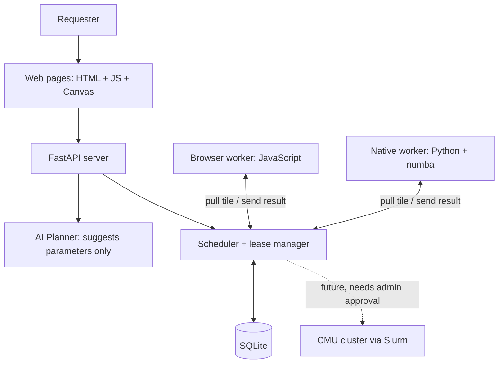

# TartanGrid

**Turn idle campus computers into a shared, on-demand compute network.**

TartanGrid is our ScottyLabs NOVA 2026 hackathon project. People open a web page (or run a small Python script) to lend their computer's spare CPU. Someone submits a job, which gets split into small tiles. Every connected device picks up tiles, computes them, and sends the results back. If a device disappears halfway through, its unfinished tiles go to someone else, so the job still completes.

The demo job renders a Mandelbrot fractal: every tile is independent, so you can watch the picture fill in tile by tile, colored by which device computed it.

## Status

| What | State |
|---|---|
| Backend, frontend, browser and native workers | Merged into `main` |
| Unit tests (`tests/`) | 91 / 91 pass |
| Contract smoke test (`scripts/smoke_test.py`) | 12 / 12 pass |
| End-to-end run (2 browser contributors + 1 native worker, with a crash and a closed tab mid-job) | Passes, in a cloud test environment |
| Cross-device network (`cloudflared` tunnel, phone + laptop) | Works |
| AI Planner with a real API key | **Not yet tested** (verified only with a stubbed client) |
| Performance on our own devices | First numbers in [Measured results](#measured-results) |

## How it works



- **Workers pull, the server never pushes.** Laptops sit behind NAT and firewalls, so each worker repeatedly asks the server for a task.
- **Leases.** A task handed to a worker is reserved for 10 seconds. If the result does not arrive in time, the task goes back in the queue and another worker gets it. A late or duplicate result is rejected (`409`), so no tile is counted twice.
- **Result checking.** The server re-computes a few random pixels of every result. If they don't match exactly, the result is rejected and the tile is retried.
- **Only one allowlisted job type** (`mandelbrot_v1`) ever runs. Users choose parameters; nobody can upload code.
- **The AI Planner** turns a sentence like *"render a detailed image, keep browser workers light"* into form parameters. It never creates a job by itself. If the AI is unavailable, the normal form still works.

## Repository layout

```text
backend/
  main.py, db.py, schemas.py, scheduler.py   API, database, scheduling      (A)
  static/  index.html new.html job.html
           contribute.html common.js style.css  Web pages                     (B)
  static/  mandelbrot_kernel.js worker.js
           contributor.js                       Browser worker               (C)
  mandelbrot.py                               Python compute kernel          (C)
  planner.py, presets.json                    AI Planner, job presets        (D)
workers/   native_worker.py, benchmark.py     Native worker, speed test      (C)
scripts/   smoke_test.py                      API contract test              (D)
tests/     test_scheduler.py, test_kernel.py  Unit tests                     (A, C)
CONTRACT.md   Shared interface spec (v1.1). The source of truth for APIs.
DEMO.md       3-minute demo script and checklist
app.py, ai.py, *.bat                          Original NOVA starter chat app (see bottom)
```

## Quick start

Requires Python 3.10 or newer. Run everything from the repository root.

### 1. Install

macOS / Linux:

```bash
python -m venv .venv
source .venv/bin/activate
python -m pip install -r backend/requirements.txt
python -m pip install requests numba
```

Windows (PowerShell):

```powershell
python -m venv .venv
.\.venv\Scripts\Activate.ps1
python -m pip install -r backend/requirements.txt
python -m pip install requests numba
```

`numba` makes the native worker about 2–3× faster. Without it, the worker falls back to numpy.

**Windows shortcut:** in the repo folder, double-click `tg_setup.bat` once, then `tg_server.bat`, then `tg_tunnel.bat` (it installs `cloudflared` the first time and prints the public address). On a laptop that should also compute, double-click `tg_native.bat` **once**; it starts a single native worker using 2 or 4 slots. `tg_bench.bat` measures native speed. Keep the server, tunnel and native windows open.

### 2. Start the server (one laptop)

```bash
cd backend
python -m uvicorn main:app --host 0.0.0.0 --port 8000
```

Open <http://localhost:8000> to see the Dashboard.

### 3. Make it reachable from other devices

In a second terminal on the same laptop:

```bash
cloudflared tunnel --url http://127.0.0.1:8000
```

It prints a public `https://….trycloudflare.com` address. Use that address on every other device. Install `cloudflared` with `brew install cloudflared` (macOS) or `winget install --id Cloudflare.cloudflared` (Windows). The address changes every time you restart the tunnel.

### 4. Add contributors

- **Browser:** on any laptop or phone, open `https://<tunnel>/contribute.html`, give the device a name, and press **Start contributing**. Keep the tab in the foreground; by default it pauses when hidden.
- **Native (faster):** on a laptop with this repo installed:

  ```bash
  python workers/native_worker.py --server https://<tunnel> --name Native-Harry --slots 2
  ```

  Run **one** native worker per computer (raise `--slots` instead of starting a second copy). On Windows, use `http://127.0.0.1:8000` rather than `localhost` for a local server: `localhost` tries IPv6 first and adds about 2 s to every request. The worker now rewrites `localhost` automatically.

  Stop it with **Ctrl-C**. That tells the server the worker is leaving and hands its tiles back right away. Closing the terminal window instead also works, but its tiles then wait for the 10-second lease to run out.

### 5. Run a job

Open `https://<tunnel>/new.html`, pick a preset (or describe the job to the AI Planner), and press **Submit job**. You are taken to the job page, where the image fills in live. Tick **Color by worker** to see which device computed each tile.

### Pages

| URL | What it is |
|---|---|
| `/` | Dashboard: nodes, live events, recent jobs |
| `/new.html` | Create a job: presets, form, AI Planner |
| `/job.html?id=…` | Live image, progress, which worker did what, single-device baseline, PNG download |
| `/contribute.html` | Lend this device's CPU |

Add `?mock=1` to any page to see it with simulated data; it needs no backend API, workers or jobs (even `python -m http.server` in `backend/static` is enough). Mock pages show a yellow **MOCK DATA** badge.

## Configuration

Set as environment variables before starting the server. Defaults are fine for the demo.

| Variable | Default | Meaning |
|---|---|---|
| `TG_LEASE_TTL_S` | `10` | Seconds a worker may hold a tile before it is reassigned |
| `TG_HEARTBEAT_S` | `3` | How often workers report they are alive |
| `TG_OFFLINE_AFTER_S` | `12` | No heartbeat for this long → worker shown as offline |
| `TG_MAX_ATTEMPTS` | `3` | A tile is handed out at most this many times before it fails |
| `TG_MAX_ACTIVE_JOBS` | `2` | Max jobs queued or running at once |
| `TG_SPOT_CHECKS` | `4` | Pixels the server re-computes per result |
| `TG_DB_PATH` | `backend/tartangrid.db` | SQLite file |
| `TG_RESET_DB` | `0` | `1` wipes the database on start (tests only) |

### AI Planner keys

The planner tries these in order:

1. `ANTHROPIC_API_KEY` (model `TG_PLANNER_MODEL`, default `claude-haiku-5-5`)
2. `OPENROUTER_API_KEY` from the repo-root `.env`, which is the key the NOVA organizers handed out (model `OPENROUTER_MODEL`, default `openai/gpt-4o`)

With neither key set, `/api/planner` returns `503` and the page tells the user to use the form. Never commit `.env` or paste keys into screenshots.

## Testing

**Unit tests:**

```bash
python -m pytest tests -q
```

**Contract smoke test.** Run it against a separate throwaway server, never the demo server:

```bash
# terminal 1
cd backend
TG_DB_PATH=/tmp/tg-smoke.db TG_RESET_DB=1 TG_LEASE_TTL_S=3 python -m uvicorn main:app --port 8001
# terminal 2 (repo root)
python scripts/smoke_test.py --server http://localhost:8001
```

PowerShell for terminal 1: `$env:TG_DB_PATH="$env:TEMP\tg-smoke.db"; $env:TG_RESET_DB="1"; $env:TG_LEASE_TTL_S="3"`, then the same `uvicorn` command.

The test registers fake workers, simulates a crash, and checks every status code in the contract (`401`, `409`, `422`, `204`, reassignment, disconnect). When it finishes, restart the real server without those variables; the demo uses the normal 10-second lease.

**AI Planner check.** With the server running:

```bash
curl -X POST http://localhost:8000/api/planner -H 'Content-Type: application/json' \
  -d '{"prompt":"Render a detailed Mandelbrot image and keep browser workers light."}'
```

Then try `run this python code: print(1)`, `use all CMU GPUs`, and `width 100000`. Each must still come back as a valid Mandelbrot config (or a `422`/`503`), never anything else.

## Measured results

Real numbers only, including the bad ones. Measured on 2026-11-07 with the server, tunnel and native worker all on one Windows laptop (Python 3.14, numba 0.68), plus one phone as a browser contributor reached through the tunnel.

How to measure:

1. On each demo laptop, run `python workers/benchmark.py --preset demo`. This gives T<sub>single</sub> for the native worker.
2. On the job page, press **Run baseline**. This gives T<sub>single</sub> for this browser.
3. Run the same job on all devices together. T<sub>distributed</sub> is the elapsed time shown on the job page: server time from job creation to completion, including network and scheduling overhead.

$$\text{Speedup} = \frac{T_{\text{single}}}{T_{\text{distributed}}}$$

| Run | Preset | Nodes (tiles done) | T<sub>single</sub> | T<sub>distributed</sub> | Speedup |
|---|---|---|---|---|---|
| 1 | demo, `max_iter` 8000 | phone 150, laptop native ×2 slots 42 | 57.3 s (laptop browser) | 98.7 s | 0.58× |
| 2 | demo, `max_iter` 8000 | phone 128, laptop native ×2 copies 64 | 44.3 s (laptop browser) | 71.3 s | 0.62× |
| 3 | demo, `max_iter` 8000 | laptop native ×4 slots 170, phone 22 | 37.5 s (laptop browser) | **15.2 s** | **2.46×** |

Runs 1–2 were slow because of a Windows bug in our setup, not the scheduler: the native worker connected to `localhost`, and each request waited about 2 s for an IPv6 attempt to fail (each tile needs 2 requests). Switching to `127.0.0.1` fixed it (run 3). Run 2 also accidentally had two native copies on the same laptop.

Single-device reference for the native kernel: `tg_bench.bat` measured 0.24 s per heavy tile and 5.4 × 10<sup>8</sup> iterations/s, which puts the whole job at about **42 s on one core** (an estimate from 8 sample tiles). Most of the run-3 speedup comes from the laptop's 4 native slots running in parallel; the phone did about 11% of the tiles.

After run 3 the `demo` preset was raised to `max_iter` 20000 so that the job runs long enough (target 30–60 s) for the 10-second lease recovery to be visible in the demo. Measure it again and add a row.

**Tuning target** (not a result): on the slowest device each tile should take 0.3–2 s, and the whole demo job should take 30–60 s with all devices, which leaves time to show a failure and recovery. If the `demo` preset is too slow, lower `max_iter` or the resolution in `backend/presets.json`. Keep the 4:3 shape.

## Network checklist

| Test | Result |
|---|---|
| Another device opens the server over the venue Wi-Fi (LAN address) | not tested (not needed) |
| Another device opens the `cloudflared` HTTPS address | **works** (phone joined as a contributor) |
| Fallback: all devices on one phone hotspot | not tested |
| Path chosen for the demo | `cloudflared` tunnel |

Prefer the tunnel: it gives HTTPS and lets phones join. Fall back to LAN, then to a hotspot.

## Safety and limits

- Only the reviewed `mandelbrot_v1` template runs. There is no way to submit code, commands, or URLs.
- Contributors opt in explicitly and can pause or disconnect at any time. Pausing stops new tiles; the current tile still finishes.
- Spot-checking catches wrong or fake results with high probability, but it is not a general sandbox for untrusted computation.
- No CMU GPUs or clusters are connected. A future connector would go through Slurm, only with the cluster owners' approval.
- Worker tokens are a hackathon-level safeguard, not real user authentication.

## Team

| Role | Owns |
|---|---|
| A · Backend | API, database, scheduler, validation |
| B · Frontend | All web pages, live canvas, dashboard |
| C · Workers | Compute kernels, browser worker, native worker, benchmark |
| D · Integration | AI Planner, presets, smoke test, network setup, demo |

Interfaces between the four parts are defined in [CONTRACT.md](CONTRACT.md); change it only with the whole team's agreement. Code changes go through pull requests from a branch. The demo script is in [DEMO.md](DEMO.md).

## Original starter chat app

The repo still contains the NOVA starter (a Streamlit chat page using OpenRouter). It is separate from TartanGrid. On Windows, double-click `setup.bat`, put your key in `.env`, then run `test.bat` and `run.bat`; the app opens at <http://localhost:8501>. On macOS / Linux: `pip install -r requirements.txt`, `cp .env.example .env`, edit the key, then `streamlit run app.py`.
