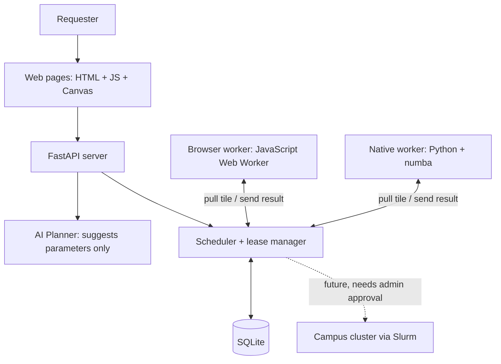

# TartanGrid

**Turn idle campus computers into a shared, on-demand compute network.**

TartanGrid is our ScottyLabs NOVA 2026 hackathon project. Anyone can lend a computer's spare CPU by opening a web page or running a small Python script. A submitted job is split into small tiles; every connected device pulls tiles, computes them and sends the results back. If a device disappears halfway through, its unfinished tiles are reassigned, so the job still completes.

The demo workload renders a Mandelbrot fractal. Every tile is independent, so you can watch the image fill in live, colored by the device that computed each tile.

## Results on real devices

Measured on 2026-11-07 with three teammates' devices connected through a public `cloudflared` tunnel:

| | |
|---|---|
| **3 devices, 3 owners** (one laptop running the native worker + browsers on two teammates' devices) | 2048×1536 image, `max_iter` 20000, 192 tiles in **25.8 s**, 0 failed |
| Same job in one browser thread | 97.2 s → **3.76×** faster |
| Same job on the server laptop alone (4 native slots) | 43.2 s → **1.67×** faster |
| **Live fault drill**: a contributor's tab closed mid-job | its lease expired, another device took the tile on attempt 2, job finished in 31.8 s with **0 failed tiles** |
| AI Planner with a real key | a normal prompt and 3 hostile prompts (`run this python code`, `use all CMU GPUs`, `width 100000`) all produced only valid Mandelbrot parameters |

All times are end-to-end (network, scheduling and validation included). Full table, including the slow early runs, in [Measured results](#measured-results).

## How it works



- **Workers pull; the server never pushes.** Laptops and phones sit behind NAT and firewalls, so each worker asks the server for work. Faster devices come back sooner and therefore get more tiles; no tuning is needed.
- **Leases.** A tile handed to a worker is reserved for 10 seconds. If no result arrives in time, the tile goes back in the queue. Late or duplicate results are rejected (`409`), so no tile is counted twice. A worker that leaves cleanly releases its tiles immediately.
- **Result checking.** The server recomputes 8 random pixels of every result. Any mismatch rejects the result and retries the tile. This is probabilistic checking, not a guarantee against all cheating.
- **One allowlisted job type.** Only the reviewed `mandelbrot_v1` template runs. Users choose parameters; nobody can upload code to someone else's device.
- **Contribution tracking.** Each device keeps a random ID. Accepted work is credited as verified iterations, so a slower device does not earn more by taking longer.

## Features

| Page | What you can do |
|---|---|
| **Dashboard** `/` | Live node list (browser / native, online / paused / offline), event feed with highlighted reassignments, recent jobs, top contributors, protected submission audit |
| **New Job** `/new.html` | Pick a preset, edit parameters, or describe the job in one sentence to the **AI Planner**, which fills in the form; nothing runs until you press Submit |
| **Job** `/job.html?id=…` | Image drawn tile by tile, outlines on tiles being computed, **Color by worker** overlay, per-worker tile counts, **Run baseline** (single-device timing and speedup), PNG download |
| **Contribute** `/contribute.html` | Lend this device: name, optional owner label, slots, Start / Pause / Resume / Disconnect, auto-pause when the tab is hidden; works on phones |
| **Contributions** `/contributions.html` | Ranking of verified work per device with share, time filters and CSV export. Devices without an owner label are hidden by default; nothing is deleted |

Add `?mock=1` to any page to see it with simulated data and no backend. Mock pages show a yellow **MOCK DATA** badge.

## Quick start

Requires Python 3.10 or newer. Run commands from the repository root.

**1. Install**

```bash
python -m venv .venv
source .venv/bin/activate            # Windows: .\.venv\Scripts\Activate.ps1
python -m pip install -r backend/requirements.txt
python -m pip install requests numba # numba makes the native worker 2–3× faster; optional
```

**2. Start the server** (one computer)

```bash
cd backend
python -m uvicorn main:app --host 0.0.0.0 --port 8000
```

Open <http://localhost:8000>.

**3. Make it reachable** (same computer, second terminal)

```bash
cloudflared tunnel --url http://127.0.0.1:8000
```

It prints a public `https://….trycloudflare.com` address for every other device. Install with `brew install cloudflared` (macOS) or `winget install --id Cloudflare.cloudflared` (Windows). The address changes each time the tunnel restarts.

**4. Add contributors**

- *Browser:* open `https://<tunnel>/contribute.html` on any laptop or phone and press **Start contributing**. Keep the tab in the foreground: hidden tabs pause by default, and browsers slow down background tabs heavily.
- *Native:* `python workers/native_worker.py --server https://<tunnel> --name MyLaptop --slots 2 --owner myid`. Run one copy per computer (raise `--slots` instead of starting another). Stop it with **Ctrl-C** so its tiles are released immediately.

**5. Run a job.** Open `https://<tunnel>/new.html`, choose the **Demo** preset and press **Submit job**. Submit from a device that is not contributing, or from a separate window, so the contributing tab stays visible.

**Windows shortcuts.** Double-click `tg_setup.bat` once, then `tg_server.bat` and `tg_tunnel.bat`. The tunnel script installs `cloudflared` on first use and logs the address to `tg_tunnel.log`. `tg_native.bat` starts one native worker with 2–4 slots; set `OWNER` near its top. `tg_bench.bat` measures native speed. Keep the server, tunnel and native windows open.

**AI Planner key (optional).** Copy `.env.example` to `.env` and set `OPENROUTER_API_KEY`, or set `ANTHROPIC_API_KEY`, which takes precedence. Without a key the planner returns `503` and the form still works. Never commit `.env`.

## Configuration

Environment variables for the server; defaults are what we demo with.

| Variable | Default | Meaning |
|---|---|---|
| `TG_LEASE_TTL_S` | `10` | Seconds a worker may hold a tile before it is reassigned |
| `TG_HEARTBEAT_S` | `3` | Worker heartbeat interval |
| `TG_OFFLINE_AFTER_S` | `12` | No heartbeat for this long → shown as offline |
| `TG_MAX_ATTEMPTS` | `3` | A tile is handed out at most this many times |
| `TG_MAX_ACTIVE_JOBS` | `2` | Jobs queued or running at once |
| `TG_SPOT_CHECKS` | `8` | Pixels recomputed per result |
| `TG_DB_PATH` | `backend/tartangrid.db` | SQLite file; older databases are migrated in place on startup |
| `TG_RESET_DB` | `0` | `1` wipes the database on start (tests only) |
| `TG_SECURITY_AUDIT_TOKEN` | unset | Dedicated audit-read credential: 32–256 URL-safe characters. Missing/invalid configuration disables reading; submissions are still recorded |

## Contribution tracking

- **Credit** is the sum of per-pixel iteration counts in accepted, spot-checked results, shown in **Miter** (one million iterations). Rejected, stale and duplicate submissions earn nothing. A reassigned tile credits only the device whose result was accepted. CPU time and online time are shown for context only.
- **Identity.** The browser stores a random `dev_…` ID in localStorage, and the native worker stores one in `~/.tartangrid/device_id`. Reloads and restarts merge into one row. IDs use no hardware fingerprint, so a browser and a native worker on the same computer appear as two rows.
- **Owner** is an optional, public label (for example an Andrew ID) that helps the team match rows to people. It is not authentication.
- **Points only.** There is no money, no token and no redemption; rewards are decided by the team.
- **API:** `GET /api/contributions` returns JSON and `GET /api/contributions.csv` returns CSV; both accept ISO `since` / `until` filters.

## Submission security audit (Sandia demo slice)

Every HTTP job submission records the result of the existing server checks: accepted jobs, unknown task types/fields, malformed JSON, invalid parameters and the global active-job limit. The event contains a server-generated request ID, UTC time, decision, fixed redacted reason and a job ID only on success. The same request ID is returned in `X-Request-ID`. No request body, prompt, IP, owner label, token or API key is stored in the audit table.

This feature adds evidence for existing controls. It does **not** add requester authentication, per-user quotas, GPU/HPC permissions, a new policy engine or general prompt-injection protection. All submitters are labeled `anonymous`; a contribution owner is not a verified identity. Existing Planner and Worker access rules remain unchanged. The audit reader credential only permits viewing the audit; it is separate from Worker tokens and model API keys.

The operator sets `TG_SECURITY_AUDIT_TOKEN` in the server process environment before starting it. It has no built-in default and is not loaded from `.env` by this feature. Example in PowerShell, from the repository root:

```powershell
$env:TG_SECURITY_AUDIT_TOKEN = & .\.venv\Scripts\python.exe -c "import secrets; print(secrets.token_urlsafe(32))"
Set-Clipboard $env:TG_SECURITY_AUDIT_TOKEN
.\tg_server.bat
```

On Windows you can instead double-click **`tg_server_audit.bat`**: it creates a credential once in `tg_audit_token.txt` (git-ignored), sets `TG_SECURITY_AUDIT_TOKEN` from it and starts the server. Open that file to copy the credential; delete it to rotate.

Wait for any running jobs before restarting an existing server. Keep the tunnel running and preserve `.env` and `backend/tartangrid.db`. Store/share the reader credential privately with authorized viewers; the example keeps it in that PowerShell process and copies it to the clipboard for pasting into the Dashboard's **Security audit** field. Do not put it in a URL, screenshot or commit. Generating a new token before a later restart rotates reader access without deleting logs.

On the Dashboard, paste the credential and click **Unlock**. It is used only by the audit read request, stays in page memory, and is forgotten on **Lock**, reload or navigation. The panel polls every five seconds. Failed reads clear the displayed evidence and show **Security events unavailable**; they do not show fake zeroes. Mock mode provides no security evidence.

`GET /api/security/events?limit=50` accepts the credential as an Authorization Bearer header, returns the newest 1–100 events, and prohibits caching. Allowed/Blocked counts cover all persisted audit records in this database, not just the displayed page. Old jobs are not backfilled as audit events. Records survive server restarts; they have no automatic retention limit and are not tamper-proof. Operators should account for database growth on public deployments.

Successful submission and its allowed audit commit together. If audit storage fails, the new job and all its tasks roll back and the request returns 503; failed denial logging also returns 503 without creating work. This intentionally makes storage failure visible rather than silently losing evidence. Existing computations and worker protocols are unaffected by the read credential.

Audit feature validation on an isolated cloud server: 179 Python tests (34 audit cases), 8 Node identity tests, 7/7 audit demo and 13/13 contract smoke checks passed. Browser acceptance covered real computation plus desktop/mobile audit states. Field deployment of this audit feature is pending.

## Testing

```bash
env -u OPENROUTER_API_KEY -u ANTHROPIC_API_KEY PYTHON_DOTENV_DISABLED=1 python -m pytest tests -q   # 179 tests
node --test tests/test_contributor_identity.js                                                    # browser identity
```

**Security audit acceptance:** `python scripts/security_demo.py --server http://127.0.0.1:8001` runs seven checks against a fresh disposable server. Both processes must receive the same `TG_SECURITY_AUDIT_TOKEN`. It checks reader access, four denied requests with no work, real accepted computation, redaction and unchanged contribution credit; it refuses non-loopback URLs or a nonempty server. Use a separate fresh DB for the contract smoke below, because each script creates its own jobs.

Optional UI acceptance: install Playwright (`npm install --no-save playwright`) and Chromium, then run `node scripts/check_security_audit_ui.js`. It starts and stops its own loopback server with a temporary DB and random test credential, exercises actual browser computation plus unlock/lock/error/retry/mobile states, and prints the temporary screenshot directory. Set `TG_TEST_PYTHON` or `TG_CHROMIUM_PATH` if your Python/Chromium lives elsewhere. It never uses the live tunnel or calls the AI provider.

**Contract smoke test.** Run it against a throwaway server only, never a live demo:

```bash
# terminal 1
cd backend && TG_DB_PATH=/tmp/tg-smoke.db TG_RESET_DB=1 TG_LEASE_TTL_S=3 python -m uvicorn main:app --port 8001
# terminal 2 (repo root)
python scripts/smoke_test.py --server http://127.0.0.1:8001     # 13 stages
```

It registers simulated workers, simulates a crash, and checks `401` / `409` / `422` / `204` responses, reassignment, disconnect and contribution totals.

## Measured results

Real numbers only, including the slow ones. The server, tunnel and native worker ran on one Windows laptop (Python 3.14, numba 0.68). Browsers joined through the tunnel.

| Run | Job | Devices (tiles done) | Single-device time | T<sub>distributed</sub> | Speedup |
|---|---|---|---|---|---|
| 1 | demo, `max_iter` 8000 | phone 150, laptop native 42 | 57.3 s (laptop browser) | 98.7 s | 0.58× |
| 2 | demo, `max_iter` 8000 | phone 128, laptop native 64 (two copies by mistake) | 44.3 s (laptop browser) | 71.3 s | 0.62× |
| 3 | demo, `max_iter` 8000 | laptop native 170, phone 22 | 37.5 s (laptop browser) | 15.2 s | 2.46× |
| 4 | demo, `max_iter` 20000 | laptop native 181, second laptop's browser 11, **1 tile reassigned** | 43.2 s (run 5) | 31.8 s | 1.36× |
| 5 | same image, `max_iter` 20000, 64-px tiles | laptop native alone (4 slots) 768 | — (reference) | 43.2 s | — |
| 6 | demo, `max_iter` 20000 | laptop native 168, second laptop's browser 24 | 43.2 s (run 5) | 30.4 s | 1.42× |
| 7 | demo, `max_iter` 20000 | **3 devices, 3 owners**: laptop native 143, browser 27, browser 22 | 97.2 s (1 browser thread) · 43.2 s (run 5) | **25.8 s** | **3.76×** · **1.67×** |

$$\text{Speedup} = \frac{T_{\text{single}}}{T_{\text{distributed}}}$$

- **Runs 1–2 were slow because of a setup bug, not the scheduler.** On Windows, `localhost` first tries IPv6 and waits about 2 s before falling back. Each tile needs two requests, so the native worker lost about 4 s per tile. The worker now uses `127.0.0.1` automatically.
- **Run 5** used smaller tiles than the demo: the same pixels and iterations, but slightly more overhead per tile. Speedups against it are therefore approximate.
- **The native worker does most tiles.** It runs numba on 4 cores, while a browser tab uses one JavaScript thread. That is pull scheduling working as intended.
- Native kernel benchmark (`tg_bench.bat`): 0.24 s per heavy tile at `max_iter` 8000, 5.4 × 10<sup>8</sup> iterations/s.

## Safety and limits

- Only the reviewed `mandelbrot_v1` template runs: no uploaded code, commands or URLs. AI output is parameters only, and the server validates them like any form input.
- Contributors opt in explicitly and can pause or disconnect at any time.
- Spot checks catch wrong results with high probability. They are not a sandbox for untrusted computation.
- No campus GPUs or clusters are connected. Any future connector would go through existing schedulers (for example Slurm) with the resource owners' approval.
- Worker tokens and owner labels are hackathon-level safeguards, not user authentication.

## Roadmap

More job templates (Monte Carlo simulation, parameter sweeps, batch inference on independent inputs), CMU SSO, redundant execution for stronger verification, a native background agent with idle detection, and an approved Slurm gateway for lab clusters.

## Repository layout

```text
backend/
  main.py db.py schemas.py scheduler.py    API, database, scheduling, validation, contributions
  mandelbrot.py                            Python compute kernel (numba / numpy)
  planner.py presets.json                  AI Planner, job presets
  security_audit.py                         Persistent submission audit and protected reader API
  static/                                  Web pages, browser worker (worker.js, contributor.js, mandelbrot_kernel.js)
workers/   native_worker.py benchmark.py   Native worker, speed test
scripts/   smoke_test.py                   API contract test
           security_demo.py                Disposable-server audit acceptance
           check_security_audit_ui.js       Optional Playwright audit/UI acceptance
tests/                                     Unit tests (Python + Node)
tg_*.bat                                   Windows double-click helpers
CONTRACT.md                                Interface spec shared by the four parts (v1.3)
DEMO.md                                    Live demo script and checklist
```

## Team

| Role | Owns |
|---|---|
| A · Backend | API, database, scheduler, validation, contributions API |
| B · Frontend | Web pages, live canvas, dashboard, contributions page |
| C · Workers | Compute kernels, browser worker, native worker, benchmark |
| D · Integration | AI Planner, presets, smoke test, network setup, demo |

The four parts integrate through [CONTRACT.md](CONTRACT.md).
