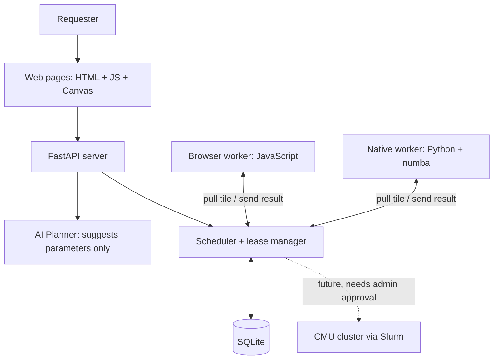

# TartanGrid

**Turn idle campus computers into a shared, on-demand compute network.**

TartanGrid is our ScottyLabs NOVA 2026 hackathon project. People open a web page (or run a small Python script) to lend their computer's spare CPU. Someone submits a job, which gets split into small tiles. Every connected device picks up tiles, computes them, and sends the results back. If a device disappears halfway through, its unfinished tiles go to someone else, so the job still completes.

The demo job renders a Mandelbrot fractal: every tile is independent, so you can watch the picture fill in tile by tile, colored by which device computed it.

## Status

| What | State |
|---|---|
| Backend, frontend, browser and native workers | Merged into `main` |
| Unit tests (`tests/`) | v1.2 cloud validation: **145 / 145 pass** (provider credentials disabled) |
| Contract smoke test (`scripts/smoke_test.py`) | v1.2 cloud validation: **13 / 13 pass**, using a disposable local DB and real computation |
| Browser identity tests (Node) | v1.2 cloud validation: **8 / 8 pass** |
| Contribution end-to-end check | Passed with real Web Workers in 2 Chromium contexts and native Python processes: 56 accepted tiles, reload/restart identity persistence, JSON/CSV agreement and responsive UI; one cloud host, not a physical-device benchmark |
| Cloud end-to-end run (2 browser contexts + 1 native worker, with a crash and closed tab) | Previous integration passed on one cloud machine; simulated contexts do not establish physical-device coverage |
| Cross-device network (`cloudflared` tunnel, phone + Windows laptop) | Works; second physical browser laptop still pending |
| AI Planner with a real API key | Cloud live-key check passed: normal + 3 hostile prompts returned valid Mandelbrot parameters; Harry’s field check pending |
| Performance on our own devices | First numbers in [Measured results](#measured-results) |
| Field failure recovery, `demo max_iter=20000` | Reported run: 31.8 s, native 181 tiles / phone 11, one lease expiry and reassignment, 0 failed |
| Same-parameter single-device baseline for `max_iter=20000` | **Not yet measured**; speedup pending |

## How it works



- **Workers pull, the server never pushes.** Laptops sit behind NAT and firewalls, so each worker repeatedly asks the server for a task.
- **Leases.** A task handed to a worker is reserved for 10 seconds. If the result does not arrive in time, the task goes back in the queue and another worker gets it. A late or duplicate result is rejected (`409`), so no tile is counted twice.
- **Result checking.** The server re-computes 8 random pixels of every result by default. If they don't match exactly, the result is rejected and the tile is retried. This is probabilistic checking, not a guarantee against all cheating.
- **Only one allowlisted job type** (`mandelbrot_v1`) ever runs. Users choose parameters; nobody can upload code.
- **The AI Planner** turns a sentence like *"render a detailed image, keep browser workers light"* into form parameters. It never creates a job by itself. If the AI is unavailable, the normal form still works.

## Repository layout

```text
backend/
  main.py, db.py, schemas.py, scheduler.py   API, database, scheduling      (A)
  static/  index.html new.html job.html
           contribute.html contributions.html
           common.js style.css                  Web pages                     (B)
  static/  mandelbrot_kernel.js worker.js
           contributor.js                       Browser worker               (C)
  mandelbrot.py                               Python compute kernel          (C)
  planner.py, presets.json                    AI Planner, job presets        (D)
workers/   native_worker.py, benchmark.py     Native worker, speed test      (C)
scripts/   smoke_test.py                      API contract test              (D)
tests/     test_scheduler.py, test_kernel.py  Unit tests                     (A, C)
CONTRACT.md   Shared interface spec (v1.2). The source of truth for APIs.
DEMO.md       3-minute-15-second demo script and checklist
app.py, ai.py, *.bat                          Original NOVA starter chat app (see bottom)
```

## Quick start

Requires Python 3.10 or newer. Run everything from the repository root.

### 1. Install

macOS / Linux:

```bash
python -m venv .venv
source .venv/bin/activate
python -m pip install -r backend/requirements.txt
python -m pip install requests numba
```

Windows (PowerShell):

```powershell
python -m venv .venv
.\.venv\Scripts\Activate.ps1
python -m pip install -r backend/requirements.txt
python -m pip install requests numba
```

`numba` makes the native worker about 2–3× faster. Without it, the worker falls back to numpy.

**Windows shortcut:** in the repo folder, double-click `tg_setup.bat` once, then `tg_server.bat`, then `tg_tunnel.bat` (it installs `cloudflared` the first time and prints the public address). On a laptop that should also compute, double-click `tg_native.bat` **once**; it starts a single native worker using 2 or 4 slots. `tg_bench.bat` measures native speed. Keep the server, tunnel and native windows open.

### 2. Start the server (one laptop)

```bash
cd backend
python -m uvicorn main:app --host 0.0.0.0 --port 8000
```

Open <http://localhost:8000> to see the Dashboard.

### 3. Make it reachable from other devices

In a second terminal on the same laptop:

```bash
cloudflared tunnel --url http://127.0.0.1:8000
```

It prints a public `https://….trycloudflare.com` address. Use that address on every other device. Install `cloudflared` with `brew install cloudflared` (macOS) or `winget install --id Cloudflare.cloudflared` (Windows). The address changes every time you restart the tunnel.

### 4. Add contributors

- **Browser:** on any laptop or phone, open `https://<tunnel>/contribute.html`, give the device a name, optionally enter **Owner (for rewards)**, and press **Start contributing**. Keep the tab in the foreground; by default it pauses when hidden.
- **Native (faster):** on a laptop with this repo installed:

  ```bash
  python workers/native_worker.py --server https://<tunnel> --name Native-Harry --slots 2
  ```

  Add `--owner hyang2` to associate the record with an optional owner label. On Windows, edit the `set "OWNER="` line near the top of `tg_native.bat`; leave it blank to omit the label.

  Run **one** native worker per computer (raise `--slots` instead of starting a second copy). On Windows, use `http://127.0.0.1:8000` rather than `localhost` for a local server: `localhost` tries IPv6 first and adds about 2 s to every request. The worker now rewrites `localhost` automatically.

  Stop it with **Ctrl-C**. That tells the server the worker is leaving and hands its tiles back right away. Closing the terminal window instead also works, but its tiles then wait for the 10-second lease to run out.

### 5. Run a job

Open `https://<tunnel>/new.html`, pick a preset (or describe the job to the AI Planner), and press **Submit job**. You are taken to the job page, where the image fills in live. Tick **Color by worker** to see which device computed each tile.

### Pages

| URL | What it is |
|---|---|
| `/` | Dashboard: nodes, live events, recent jobs |
| `/new.html` | Create a job: presets, form, AI Planner |
| `/job.html?id=…` | Live image, progress, which worker did what, single-device baseline, PNG download |
| `/contribute.html` | Lend this device's CPU |
| `/contributions.html` | Device contribution ranking, time filters, CSV download |

Add `?mock=1` to any page to see it with simulated data; it needs no backend API, workers or jobs (even `python -m http.server` in `backend/static` is enough). Mock pages show a yellow **MOCK DATA** badge.

## Contribution tracking

Open **Contributions** to see how much accepted work each device identity has contributed. Credit is the integer sum of the per-pixel iteration counts in accepted, spot-checked results, displayed as **Miter** (one million iterations). CPU time and online time are context only; a slower device does not earn more for taking longer. Rejected results, stale leases returning `409`, and duplicate submissions earn no credit. A reassigned tile credits only the worker whose final result is accepted. Validation samples 8 pixels by default; this is probabilistic and cannot detect every dishonest result.

The browser creates a random `dev_…` ID using `crypto.getRandomValues` and saves it under `tg_device_id` in localStorage. The native worker saves its independent random ID in `~/.tartangrid/device_id` (`%USERPROFILE%\.tartangrid\device_id` on Windows). Refreshes and restarts normally preserve the respective IDs. Browser storage restrictions fall back to sessionStorage, then to a temporary current-page ID; native persistence failure logs a warning and uses a session ID. Clearing storage, changing browser profiles or origins, or losing persistence can split future contributions into another row. Browser storage is tied to the site's origin, so a changed tunnel address also starts a different browser identity.

Known edge case: starting two browser tabs simultaneously before this origin has ever saved an ID can create two initial identities. Start one tab first when setting up a new browser profile; subsequent visits reuse its saved ID.

IDs use no hardware fingerprint. A browser and native worker on the **same computer normally appear as two rows** because their storage is separate; several registrations of the same saved ID aggregate into one row. Device rows and worker sessions are not proof of distinct physical machines. Optional **owner** (for example, an Andrew ID or chosen label) helps the team associate records when deciding rewards; it is not authentication, and no real identifier is required. Names and owner labels appear on the public page and CSV, so use a label you are comfortable sharing. The latest registration sets the row's name and owner; leaving owner blank on that registration clears the displayed label.

Choose **All time**, **Last hour**, or a custom interval, then click **Download CSV**. JSON is also available at `/api/contributions`; `/api/contributions.csv` exports matching rows and filters. API `since` and `until` use ISO datetimes with `Z` or an offset and include both endpoints, based on server acceptance time. Filtered views keep zero-credit, offline and departed devices; online time and registration metadata remain lifetime values. Existing database rows are migrated without deletion: older workers appear as `wkr:…`, and accepted historical results are included even when they lack stored credit.

CSV prefixes formula-like names and owner labels with an apostrophe so spreadsheets treat them as text; JSON retains the original labels. Counts and contribution values remain numeric.

**Points only, no money. Final rewards are decided by the team.** There are no payments, tokens, or redemption features. Roadmap items include optional authentication / CMU SSO, duplicate execution for stronger verification, and team-reviewed reward policy; they are not implemented. No model-based device weighting or automatic reward exchange is implemented. Any future campus-resource integration requires the resource owners' authorization.

## Configuration

Set as environment variables before starting the server. Defaults are fine for the demo.

| Variable | Default | Meaning |
|---|---|---|
| `TG_LEASE_TTL_S` | `10` | Seconds a worker may hold a tile before it is reassigned |
| `TG_HEARTBEAT_S` | `3` | How often workers report they are alive |
| `TG_OFFLINE_AFTER_S` | `12` | No heartbeat for this long → worker shown as offline |
| `TG_MAX_ATTEMPTS` | `3` | A tile is handed out at most this many times before it fails |
| `TG_MAX_ACTIVE_JOBS` | `2` | Max jobs queued or running at once |
| `TG_SPOT_CHECKS` | `8` | Pixels the server re-computes per result |
| `TG_DB_PATH` | `backend/tartangrid.db` | SQLite file |
| `TG_RESET_DB` | `0` | `1` wipes the database on start (tests only) |

### AI Planner keys

The planner tries these in order:

1. `ANTHROPIC_API_KEY` (model `TG_PLANNER_MODEL`, default `claude-haiku-5-5`)
2. `OPENROUTER_API_KEY` from the repo-root `.env`, which is the key the NOVA organizers handed out (model `OPENROUTER_MODEL`, default `openai/gpt-4o`)

With neither key set, `/api/planner` returns `503` and the page tells the user to use the form. Never commit `.env` or paste keys into screenshots.

## Testing

**Unit tests:**

```bash
env -u OPENROUTER_API_KEY -u ANTHROPIC_API_KEY PYTHON_DOTENV_DISABLED=1 python -m pytest tests -q
node --test tests/test_contributor_identity.js
```

Disable provider credentials and dotenv loading only for the unit-test process, as above; do not edit the deployment `.env`. Test databases are temporary. The Node tests cover browser identity persistence and storage fallback.

**Contract smoke test.** Run it against a separate throwaway server, never the demo server:

```bash
# terminal 1
cd backend
TG_DB_PATH=/tmp/tg-smoke.db TG_RESET_DB=1 TG_LEASE_TTL_S=3 python -m uvicorn main:app --port 8001
# terminal 2 (repo root)
python scripts/smoke_test.py --server http://127.0.0.1:8001
```

PowerShell for terminal 1: `$env:TG_DB_PATH="$env:TEMP\tg-smoke.db"; $env:TG_RESET_DB="1"; $env:TG_LEASE_TTL_S="3"`, then the same `uvicorn` command.

The 13-stage test registers three simulated workers across two device IDs, simulates a crash, and checks `401`, `409`, `422`, `204`, reassignment, and disconnect. All three workers contribute to the 48-tile quick job. The contribution check verifies grouping, exact local `compute_tile` iteration totals, and no extra credit for stale, duplicate, or rejected submissions. Its precondition rejects a nonempty server; failures return a nonzero exit code. This does not establish real-device coverage. Stop the throwaway server and remove its test environment variables when finished; the demo uses the normal 10-second lease and `TG_RESET_DB=0`.

**AI Planner check.** With the server running:

```bash
curl -X POST http://localhost:8000/api/planner -H 'Content-Type: application/json' \
  -d '{"prompt":"Render a detailed Mandelbrot image and keep browser workers light."}'
```

Then try `run this python code: print(1)`, `use all CMU GPUs`, and `width 100000`. Each must still come back as a valid Mandelbrot config (or a `422`/`503`), never anything else.

## Measured results

Real numbers only, including the bad ones. Measured on 2026-11-07 with the server, tunnel and native worker all on one Windows laptop (Python 3.14, numba 0.68), plus one phone as a browser contributor reached through the tunnel.

How to measure:

1. On each demo laptop, run `python workers/benchmark.py --preset demo`. This gives T<sub>single</sub> for the native worker.
2. On the job page, press **Run baseline**. This gives T<sub>single</sub> for this browser.
3. Run the same job on all devices together. T<sub>distributed</sub> is the elapsed time shown on the job page: server time from job creation to completion, including network and scheduling overhead.

$$\text{Speedup} = \frac{T_{\text{single}}}{T_{\text{distributed}}}$$

| Run | Preset | Nodes (tiles done) | T<sub>single</sub> | T<sub>distributed</sub> | Speedup |
|---|---|---|---|---|---|
| 1 | demo, `max_iter` 8000 | phone 150, laptop native ×2 slots 42 | 57.3 s (laptop browser) | 98.7 s | 0.58× |
| 2 | demo, `max_iter` 8000 | phone 128, laptop native ×2 copies 64 | 44.3 s (laptop browser) | 71.3 s | 0.62× |
| 3 | demo, `max_iter` 8000 | laptop native ×4 slots 170, phone 22 | 37.5 s (laptop browser) | **15.2 s** | **2.46×** |
| 4 | demo, `max_iter` 20000 | laptop native 181, phone browser 11 | **Pending — not measured** | **31.8 s** | **Pending** |

Runs 1–2 were slow because of a Windows bug in our setup, not the scheduler: the native worker connected to `localhost`, and each request waited about 2 s for an IPv6 attempt to fail (each tile needs 2 requests). Switching to `127.0.0.1` fixed it (run 3). Run 2 also accidentally had two native copies on the same laptop.

Single-device reference for the native kernel: `tg_bench.bat` measured 0.24 s per heavy tile and 5.4 × 10<sup>8</sup> iterations/s in its sampled benchmark. That is not a full-job baseline for run 4. Run 3 used 4 native slots on one laptop; the phone completed about 11% of the tiles.

After run 3 the `demo` preset was raised to `max_iter` 20000. Run 4 is the team's reported field measurement: closing the phone tab mid-job caused Task 1118 to emit `lease_expired`; native took it on attempt 2, with **one reassignment and zero failed tiles**. The same-parameter T<sub>single</sub> has not been measured, so no speedup is reported. A second physical browser laptop has not yet joined; add another measured row after that check and the baseline are complete.

**Tuning target** (not a result): on the slowest device each tile should take 0.3–2 s, and the whole demo job should take 30–60 s with all devices, which leaves time to show a failure and recovery. If the `demo` preset is too slow, lower `max_iter` or the resolution in `backend/presets.json`. Keep the 4:3 shape.

## Network checklist

| Test | Result |
|---|---|
| Another device opens the server over the venue Wi-Fi (LAN address) | not tested (not needed) |
| Another device opens the `cloudflared` HTTPS address | **works** (one phone browser joined; server and native ran on Harry's Windows laptop) |
| Second physical laptop joins through the tunnel | **Pending**; target is two browser devices plus one native worker simultaneously |
| Fallback: all devices on one phone hotspot | not tested |
| Path chosen for the demo | `cloudflared` tunnel |

Prefer the tunnel: it gives HTTPS and lets phones join. Fall back to LAN, then to a hotspot.

## Field validation and deployment

Harry's running Windows demo folder is a copied checkout at `C:\Users\yangz\Desktop\nova-starter`, not a git clone. Only Harry operates its processes, files, and database. Agents and teammates use their own temporary local server for testing; do not run smoke against the public demo URL.

After the contribution PR is merged and its checks pass, Harry should follow the deployment steps in [DEMO.md](DEMO.md): wait until no jobs are running, copy the updated files from `main` while preserving `.env` and `backend/tartangrid.db`, and restart only the server window. Leave the tunnel window running to preserve its URL. Startup migrates existing records automatically; do not set `TG_RESET_DB=1`. Refresh browser contribution pages and verify historical `wkr:…` rows plus newly accepted quick-job credit. The already-running native process keeps its loaded code until Harry later restarts it; its older registrations remain compatible and receive credit.

Still pending on physical devices: add the second browser laptop, measure the `max_iter=20000` baseline with no competing jobs, run the normal and three hostile Planner prompts with the real key, rehearse the [demo](DEMO.md) three times, and record a successful run. Trigger the browser fault near one-third progress, roughly 10 seconds after the demo job starts, while that worker holds a lease. Save actual results and device details; a cloud simulation does not complete these field checks.

## Safety and limits

- Only the reviewed `mandelbrot_v1` template runs. There is no way to submit code, commands, or URLs.
- Contributors opt in explicitly and can pause or disconnect at any time. Pausing stops new tiles; the current tile still finishes.
- Spot-checking catches wrong or fake results with high probability, but it is not a general sandbox for untrusted computation.
- No CMU GPUs or clusters are connected. A future connector would go through Slurm, only with the cluster owners' approval.
- Worker tokens are a hackathon-level safeguard, not real user authentication.

## Team

| Role | Owns |
|---|---|
| A · Backend | API, database, scheduler, validation |
| B · Frontend | All web pages, live canvas, dashboard |
| C · Workers | Compute kernels, browser worker, native worker, benchmark |
| D · Integration | AI Planner, presets, smoke test, network setup, demo |

Interfaces between the four parts are defined in [CONTRACT.md](CONTRACT.md); change it only with the whole team's agreement. Code changes go through pull requests from a branch. The demo script is in [DEMO.md](DEMO.md).

## Original starter chat app

The repo still contains the NOVA starter (a Streamlit chat page using OpenRouter). It is separate from TartanGrid. On Windows, double-click `setup.bat`, put your key in `.env`, then run `test.bat` and `run.bat`; the app opens at <http://localhost:8501>. On macOS / Linux: `pip install -r requirements.txt`, `cp .env.example .env`, edit the key, then `streamlit run app.py`.
